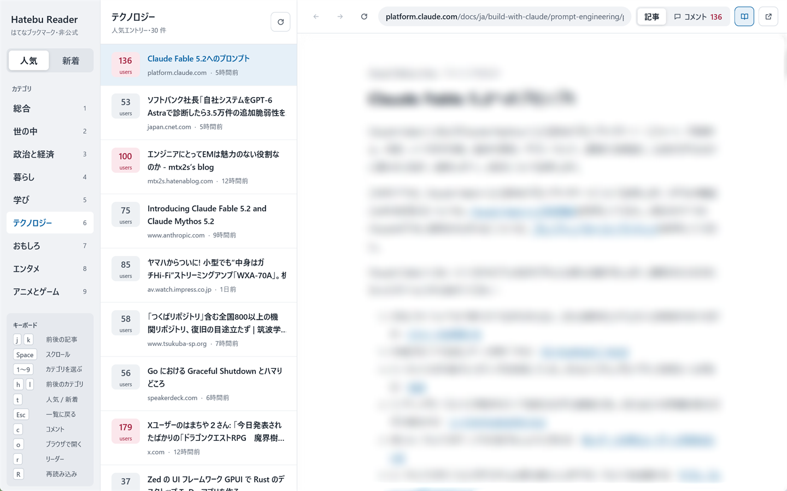

# Hatebu Reader

はてなブックマークの人気・新着エントリーを読むための、Windows・macOS 向けデスクトップアプリです。総合と 8 カテゴリの一覧から記事を開き、記事とはてなブックマークのコメントを同じ画面で切り替えて読めます。広告やメニューを除いて本文だけを読むリーダー表示や、キーボードだけでの操作にも対応しています。

株式会社はてなとは関係のない非公式のアプリです。開発者は [diffshare](https://github.com/diffshare) です。不具合や要望は [Issues](https://github.com/diffshare/HatebuReader/issues) にお寄せください。

## 入手

[Releases](https://github.com/diffshare/HatebuReader/releases) で、Windows（x64）と macOS（Apple Silicon）向けの zip を配布しています。

どちらも開発者の署名をしていないため、初回の起動時に OS の警告が出ます。

- Windows：「Windows によって PC が保護されました」と出たら、「詳細情報」から「実行」を選びます。
- macOS：`Hatebu Reader.app` を「アプリケーション」に移して開き、開けないと表示されたら「システム設定」の「プライバシーとセキュリティ」で「このまま開く」を選びます。

## キーボード操作

| キー | 動作 |
|---|---|
| `j` / `k` | 次・前の記事を開く |
| `Space` / `Shift`+`Space` | 記事を 1 画面分下・上へスクロール |
| `1`〜`9` | カテゴリを選ぶ（総合 = 1 … アニメとゲーム = 9） |
| `h` / `l` | 前後のカテゴリ |
| `t` | 人気と新着の切替 |
| `c` | 記事とコメントの切替 |
| `o` | 表示中のページをブラウザで開く |
| `r` | リーダー表示の切替 |
| `Shift`+`r` | 一覧を再読み込み |
| `Esc` | 記事ページから一覧へキー操作を戻す |

記事ページをクリックするとキー入力はページ側へ渡ります。一覧に戻すには `Esc` を押すか、一覧をクリックします。

ビルド方法や仕組みは [docs/development.md](docs/development.md) を参照してください。

## ライセンス

MIT License です（[LICENSE](LICENSE)）。同梱している Readability.js は Apache License 2.0 です（[assets/readability/LICENSE.md](assets/readability/LICENSE.md)）。配布している zip には、依存ライブラリのライセンス一覧（`THIRD-PARTY-LICENSES.html`）も入っています。
